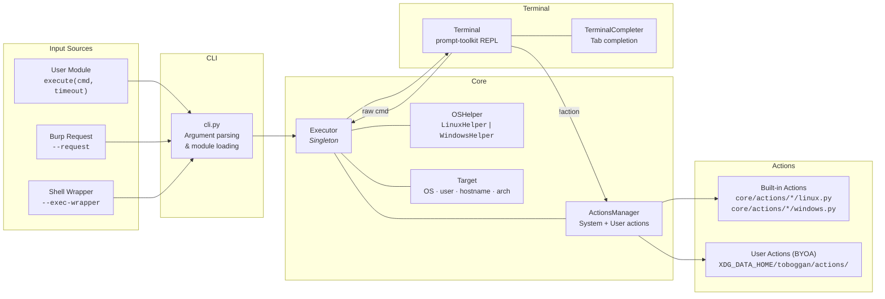

# Development Guide

This guide covers the technical architecture, project layout, and instructions for extending Toboggan.

## 🏛️ Architecture

Toboggan's runtime is a pipeline: the CLI parses arguments and loads an **execution module** (user script, Burp request, or shell wrapper), feeds it to the **Executor** singleton, which drives the **Terminal** prompt loop. Every command typed by the operator flows through optional obfuscation, the executor, and back.



### Key Components

| Component | File | Role |
|---|---|---|
| **CLI** | [`cli.py`](src/toboggan/cli.py) | Parses arguments, loads the execution module via [`modwrap`](https://pypi.org/project/modwrap/), bootstraps logging, creates the `Executor` |
| **Executor** | [`core/executor.py`](src/toboggan/core/executor.py) | Singleton that wraps the `execute()` callable. Handles OS detection, shell validation, command transformations, command-size probing, and response-time tracking |
| **Terminal** | [`core/terminal.py`](src/toboggan/core/terminal.py) | `prompt-toolkit` REPL with tab-completion, command history, action dispatch (`!` prefix), and FIFO session management |
| **Target** | [`core/target.py`](src/toboggan/core/target.py) | Holds the detected remote OS, user, hostname, initial working directory, and optional system information and architecture |
| **OSHelper** | [`core/helpers/`](src/toboggan/core/helpers/) | Abstract [`base.py`](src/toboggan/core/helpers/base.py) + OS-specific [`linux.py`](src/toboggan/core/helpers/linux.py) and [`windows.py`](src/toboggan/core/helpers/windows.py) for user lookup, path formatting, command location, named-pipe lifecycle |
| **ActionsManager** | [`core/action.py`](src/toboggan/core/action.py) | Discovers and dynamically loads action modules from both system ([`core/actions/`](src/toboggan/core/actions/)) and user directories; resolves OS-specific files (`linux.py` / `windows.py`) |
| **Handlers** | [`core/handlers/`](src/toboggan/core/handlers/) | Built-in execution backends: [`os_command.py`](src/toboggan/core/handlers/os_command.py) (shell wrapper via `subprocess`) and [`burpsuite.py`](src/toboggan/core/handlers/burpsuite.py) (Burp XML request replay via `httpx`) |
| **Utilities** | [`core/utils/`](src/toboggan/core/utils/) | Shared helpers: [`common.py`](src/toboggan/core/utils/common.py) (encoding, tokens, path validation, HTML analysis), [`jwt.py`](src/toboggan/core/utils/jwt.py) (JWT parsing), [`logbook.py`](src/toboggan/core/utils/logbook.py) (Loguru setup + XDG log paths), [`binaries.py`](src/toboggan/core/utils/binaries.py) (static binary management) |

## 🔬 Execution Internals

### Startup and Execution Backends

[`cli.py`](src/toboggan/cli.py) selects exactly one command transport:

- A user module whose callable is `execute(command, timeout)`.
- A saved Burp request handled by [`burpsuite.py`](src/toboggan/core/handlers/burpsuite.py), with `||cmd||` replaced in its URL, headers, or body.
- A local command template handled by [`os_command.py`](src/toboggan/core/handlers/os_command.py), with the target command substituted for `||cmd||`.

The supplied callable is trusted local Python code and is not sandboxed. It owns authentication, protocol details, transport encoding, response extraction, and returning clean text. Toboggan then creates the [`Executor`](src/toboggan/core/executor.py), detects the target, and starts the [`Terminal`](src/toboggan/core/terminal.py).

### Target Detection and Context

Unless `--os` is supplied, [`Executor.__guess_os()`](src/toboggan/core/executor.py) tries `ls /`, then `ver`, and otherwise assumes Linux. During initialization it uses the chosen OS helper to query the current user, hostname, and path. [`Target`](src/toboggan/core/target.py) stores those results. Its architecture is populated only when `system_info` is explicitly provided; normal executor initialization does not currently do so.

Linux shell selection tries `$0`, `zsh`, `bash`, and `sh`, validating them through common lookup commands. Windows initializes either CMD or PowerShell detection in [`WindowsHelper`](src/toboggan/core/helpers/windows.py), while named-pipe support remains Linux-only.

### Command Execution Pipeline

All raw terminal commands and action commands eventually call [`Executor.remote_execute()`](src/toboggan/core/executor.py):

1. Apply target-side obfuscation when enabled.
2. Apply transport-level base64 wrapping when enabled.
3. Invoke the selected `execute(command, timeout)` callable.
4. Track the rolling response time and retry failures up to three times.
5. Decode obfuscated output and return it as text.

Obfuscation and base64 wrapping have different contracts. The obfuscation actions create executable target-side decoding pipelines and encoded responses: [`Linux implementation`](src/toboggan/core/actions/obfuscate/linux.py) and [`Windows implementation`](src/toboggan/core/actions/obfuscate/windows.py). `-b64` only encodes the string handed to `execute()`; the transport or target must decode and evaluate it.

The maximum command size is initially 2048 bytes. `!size` can probe it, and file-transfer actions use it to choose their chunk sizes. `remote_execute()` does not automatically split arbitrary commands.

### Linux Command Discovery

The OS-independent contract is defined in [`helpers/base.py`](src/toboggan/core/helpers/base.py), while [`LinuxHelper.get_command_location()`](src/toboggan/core/helpers/linux.py) resolves a target utility in this order:

1. Return a cached result, including a cached miss.
2. Test executable files under the operator-supplied `--path` and `--paths` directories.
3. Use `/bin/busybox <command>` if BusyBox has previously been checked and exposes the applet.
4. Retry the lookup method that previously succeeded.
5. Try `command -v`, `which`, `type`, and `whence` in sequence.
6. Cache and return an empty result if all methods fail.

Actions should use `self._os_helper.get_command_location()` when utility availability or a constrained `PATH` matters. `!paths add` updates custom locations, while `!paths clear` clears the command-location cache. Empty locations must be treated as unsupported commands rather than executable paths.

BusyBox detection is lazy through `LinuxHelper.is_busybox_present`; `get_command_location()` itself does not trigger the check. Preserve that distinction or test and document an intentional change to it.

### Actions and FIFO Sessions

[`ActionsManager`](src/toboggan/core/action.py) discovers compatible `linux.py` or `windows.py` files beneath [`core/actions/`](src/toboggan/core/actions/) and the platform user-data directory. User modules take precedence over built-ins. Standard actions inherit `BaseAction`; persistent channels inherit `NamedPipe`.

The Linux [`FIFO action`](src/toboggan/core/actions/fifo/linux.py) creates an input FIFO and starts a long-lived `tail -f <stdin> | <shell> > <stdout> 2>&1` pipeline. Each operator command is written to the FIFO through the original RCE channel, while a daemon thread polls and truncates the output file. This preserves shell state but does not provide a real PTY or forward control characters. On exit, Toboggan stops the poller, kills the recorded pipeline process, and removes both paths.

### Files, State, and Cleanup

- The executor creates its remote working directory lazily, when an action first needs it, and attempts recursive deletion on normal exit. See [`Executor.working_directory`](src/toboggan/core/executor.py).
- Upload and download actions stage encoded data remotely and use local temporary files: [`upload actions`](src/toboggan/core/actions/upload/) and [`download actions`](src/toboggan/core/actions/download/).
- The FIFO action creates random remote paths under `/dev/shm`, `/tmp`, or `/var/tmp` unless paths are supplied.
- `ssh_backdoor` modifies `authorized_keys` and writes a private key to the operator's current directory. See [`ssh_backdoor/linux.py`](src/toboggan/core/actions/ssh_backdoor/linux.py).
- `drop_bin`, `drop_static`, and `peas` deliberately leave useful target artifacts or asynchronous work behind. See [`core/actions/`](src/toboggan/core/actions/).
- Logs, optional persistent command history, and downloaded static binaries use XDG or platform data directories. See [`logbook.py`](src/toboggan/core/utils/logbook.py), [`terminal.py`](src/toboggan/core/terminal.py), and [`binaries.py`](src/toboggan/core/utils/binaries.py).

Cleanup is best-effort. Transport failure, forceful termination, or a failed partial action can leave remote artifacts behind, so actions that create them should retain enough information to remove them explicitly.

## 📂 Project Layout

```
src/toboggan/
├── __init__.py              # Version resolution (importlib.metadata → pyproject.toml fallback)
├── __main__.py              # python -m toboggan entry point
├── banner.py                # ASCII art banner
├── cli.py                   # Argument parsing, module loading, Executor bootstrap
└── core/
    ├── executor.py          # Singleton: remote execution, OS detection, obfuscation
    ├── target.py            # Remote system info (OS, user, hostname, arch)
    ├── terminal.py          # prompt-toolkit REPL, action dispatch, FIFO management
    ├── action.py            # BaseAction, NamedPipe ABCs, ActionsManager (discovery + loading)
    ├── actions/             # Built-in action plugins (one subdir per action)
    │   ├── download/        #   linux.py + windows.py
    │   ├── upload/          #   linux.py + windows.py
    │   ├── fifo/            #   linux.py (mkfifo forward shell)
    │   ├── obfuscate/        #   Target-side AES/base64 command wrapping
    │   ├── deobfuscate/      #   Decode obfuscated command output
    │   └── ...              #   netcheck, ip, users, history, privbins, ssh_find, …
    ├── handlers/            # Execution backends
    │   ├── os_command.py    #   subprocess wrapper (--exec-wrapper)
    │   └── burpsuite.py     #   Burp XML request replay (--request)
    ├── helpers/             # OS-specific logic
    │   ├── base.py          #   OSHelperBase ABC
    │   ├── linux.py         #   LinuxHelper: command location, busybox, named pipes
    │   └── windows.py       #   WindowsHelper: PowerShell detection, path formatting
    └── utils/
        ├── common.py        # Encoding, tokens, path validation, HTML analysis
        ├── jwt.py           # JWT parsing and TokenReader
        ├── logbook.py       # Loguru config, XDG log directory resolution
        └── binaries.py      # Static binary cache management
```

## 🎬 Adding a New Action

### Step 1: Create the Action Directory

Create a subdirectory under `src/toboggan/core/actions/` named after your action, with OS-specific files:

```
src/toboggan/core/actions/
  my_action/
    linux.py      # Linux implementation
    windows.py    # Windows implementation (optional)
```

### Step 2: Implement the Action Class

For a standard action, inherit from `BaseAction` and implement `run()`:

```python
from toboggan.core.action import BaseAction


class MyAction(BaseAction):
    DESCRIPTION = "Short description shown in !help"

    def run(self, target_path, recursive=False):
        # self._executor  - remote command execution
        # self._os_helper - OS-specific helpers (command lookup, path formatting, etc.)

        result = self._executor.remote_execute(f"ls -la {target_path}")
        return result
```

For a named-pipe (FIFO) action, inherit from `NamedPipe` and implement `setup()`, `execute()`, and `_stop()`:

```python
from toboggan.core.action import NamedPipe


class MyPipe(NamedPipe):
    DESCRIPTION = "Interactive pipe-based session"

    def setup(self):
        # Create pipes on the remote system
        ...

    def execute(self, command):
        # Send command through the pipe
        ...

    def _stop(self):
        # Clean up pipes and background processes
        ...
```

Actions are automatically discovered by `ActionsManager`, no registration needed. The filename (`linux.py` / `windows.py`) determines which OS the action is available for.

### Step 3: User Actions (BYOA)

User-defined actions follow the same structure but live in the user data directory:

| Platform | Path |
|---|---|
| Linux/macOS | `$XDG_DATA_HOME/toboggan/actions/` (default: `~/.local/share/toboggan/actions/`) |
| Windows | `%LOCALAPPDATA%\toboggan\actions\` |

User actions take priority over built-in ones with the same name, allowing overrides.

## 🧪 Testing

Run the test suite with:

```shell
uv run pytest -v
```

Tests are in the `tests/` directory. Platform-specific tests use `@pytest.mark.skipif` to run only on the appropriate OS (e.g., Windows logbook path tests skip on Linux and vice versa).
